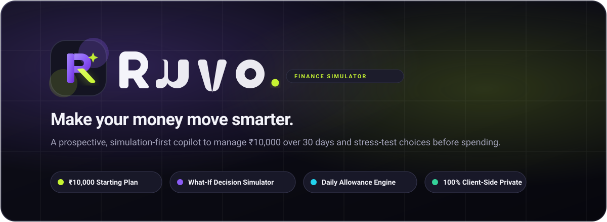

<div align="center">

  

  <p><strong>Ruvo — Understand your money. Plan your future.</strong></p>

  <p>
    A prospective, simulation-first personal finance application designed for Gen Z and early-career earners.<br />
    Manage a ₹10,000 budget over a 30-day runway and stress-test purchasing decisions before spending.
  </p>

  <p>
    <a href="https://react.dev/"></a>
    <a href="https://www.typescriptlang.org/"></a>
    <a href="https://vite.dev/"></a>
    <a href="https://tailwindcss.com/"></a>
    <a href="https://motion.dev/"></a>
    <a href="https://vitest.dev/"></a>
    <a href="https://eslint.org/"></a>
    
  </p>

  <p>
    <a href="#1-project-overview">Overview</a> •
    <a href="#2-features">Features</a> •
    <a href="#3-screenshots-and-application-preview">Screenshots</a> •
    <a href="#4-technology-stack">Tech Stack</a> •
    <a href="#5-getting-started-and-prerequisites">Getting Started</a> •
    <a href="#8-available-scripts">Scripts</a> •
    <a href="#9-project-structure">Structure</a> •
    <a href="#11-ui-design-system-and-animations">Design System</a>
  </p>

</div>

<p align="center">
  
</p>

---

## 1. Project Overview

Most financial management tools are **retrospective**: they ingest bank feeds and show you what you spent yesterday or last month. By the time a chart turns red, the money is already gone.

**Ruvo** flips this paradigm with a **simulation-first, prospective model**:
- **Baseline Model**: Designed around a ₹10,000 starting budget mapped across a 30-day period.
- **Ring-Fenced Obligations**: Automatically protects upcoming fixed commitments (bills, passes, subscriptions) and planned savings targets from discretionary spending.
- **Dynamic Daily Allowance**: Calculates how much you can safely spend today without jeopardizing the rest of your month.
- **What-If Foresight**: Allows you to simulate hypothetical purchases, income events, or subscription cancellations before money leaves your account.
- **Client-Side Privacy**: Operates 100% offline in the browser without requiring bank linking, UPI permissions, or cloud credentials.

---

## 2. Features

### Implemented Features (Live in Codebase)

- **Editorial Marketing Landing Page (`/`)**:
  - **Hero Presentation**: High-contrast headline typography utilizing *Unbounded*, brand gradients, concise Gen Z value proposition, and prominent CTAs (`Explore Ruvo`, `Start your plan`).
  - **Live Layered Dashboard Preview**: Floating UI cards exhibiting the ₹10,000 starting plan, ₹246 daily buffer, 30-day countdown, burn meter, and floating oscillating accessory cards.
  - **Asymmetric Feature Showcase**: Custom grid presenting Smart Budget Tracking, What-If Simulator, Autonomous Savings, Subscriptions & Dues, 30-Day Projections, and Financial Health & Risk Index.
  - **Interactive Purchase Simulator**: An isolated sandbox directly on the landing page where visitors can input any hypothetical purchase (or choose presets like ₹500, ₹1,500, ₹3,000, ₹5,000) and immediately watch their remaining balance and daily allowance recalculate with smooth Framer Motion transitions.
  - **Responsive Navigation**: Backdrop-blur header with smooth-scrolling section links and animated mobile drawer.

- **Application Workspace Shell (`/app`)**:
  - **Adaptive AppShell (`AppShell.tsx`)**: Desktop sidebar with active tab border indicators, month cycle tracker (`Day 1 of 30`), and profile mark; plus a thumb-friendly mobile bottom tab bar.
  - **Overview Dashboard (`DashboardPage.tsx`)**: Hero budget card with ambient glows, starting balance presentation, period setup details, and transparency notices.
  - **Reusable Metric Primitives (`MetricCard.tsx`)**: Standardized financial cards featuring status tones (`good`, `watch`, `bad`), trend arrows, and hover scaling.
  - **Foundation Progress Pages**: Integrated placeholder routes for Month Planning (`/app/plan`), Goals (`/app/goals`), and Decision Simulation (`/app/simulate`) with animated progress indicators and transparent architectural notes.

- **Design System & Financial Precision**:
  - Semantic CSS variable design tokens mapped through Tailwind CSS.
  - Standard integer-paise currency formatting helper (`formatMoney`) using Indian Rupee notation (`₹`).
  - Framer Motion animation engine with automatic `prefers-reduced-motion` compliance.

### Planned Features (Roadmap Phases 2–5)

The following capabilities are formally specified in the project documentation (`docs/`):

- [ ] **Pure Domain Calculation Engine (`src/domain/`)**: Pure TypeScript calculation module (`computeSnapshot(state)`) determining safe-to-spend envelopes ($S = B + I - D - U - G$), daily allowance ($A$), and spending pace.
- [ ] **Zustand State Store & Persistence (`src/store/`)**: Local fact storage persisting under `ruvo:v1` with Zod schema validation and automatic fallback migrations.
- [ ] **Multi-Scenario Decision Simulator**: Comparison suite testing purchases, income deltas, and commitment pauses against active plans with 1-paise confirmation equivalence.
- [ ] **Visual Trajectory Analytics**: Interactive Recharts 30-day burn curves, zero-day indicators, and category allocations.
- [ ] **Subscription & Commitment Manager**: Recurring billing calendar with mark-as-paid reconciliation.

---

## 3. Screenshots and Application Preview

> *Note: Screenshots are currently represented by asset placeholders. Capture and place image files in `docs/images/` to display live UI previews.*

| View | Suggested Asset Path | Description |
| :--- | :---: | :--- |
| **Landing Page** | `docs/images/landing-page.png` | Editorial hero, visual preview mockups, and feature cards |
| **Simulator Sandbox** | `docs/images/decision-simulation.png` | Real-time purchase impact calculator with dynamic allowance adjustment |
| **Workspace Overview** | `docs/images/dashboard-overview.png` | ₹10,000 starting budget card, quick stats, and period setup |
| **Month Plan** | `docs/images/budget-plan.png` | Category envelopes, fixed commitments, and planned discretionary spend |
| **Savings Goals** | `docs/images/savings-goals.png` | Priority-ranked savings targets and projected completion status |

---

## 4. Technology Stack

| Category | Technology | Version | Purpose in Ruvo |
| :--- | :--- | :--- | :--- |
| **UI Library** | [React](https://react.dev/) | `^18.3.1` | Declarative component framework |
| **Language** | [TypeScript](https://www.typescriptlang.org/) | `~5.7.3` | Strict static typing and code reliability |
| **Build Tool** | [Vite](https://vite.dev/) | `^6.2.2` | Rapid HMR development server and production bundler |
| **Styling** | [Tailwind CSS](https://tailwindcss.com/) | `^3.4.17` | Utility-first styling with token variables |
| **Component System** | [shadcn/ui Pattern](https://ui.shadcn.com/) | New York / CSS vars | Accessible, token-driven component architecture |
| **Class Composition** | `clsx` & `tailwind-merge` | `^2.1.1` / `^3.7.0` | Safe conditional class composition |
| **Variant Styling** | `class-variance-authority` | `^0.7.1` | Type-safe component variant definitions (`cva`) |
| **Animation Engine** | [Motion for React / Framer Motion](https://motion.dev/) | `^11.18.2` | Fluid transitions, springs, and layout animations |
| **Vector Icons** | [Lucide React](https://lucide.dev/) | `^0.468.0` | Crisp, scalable UI icons |
| **Routing** | [React Router DOM](https://reactrouter.com/) | `^6.30.1` | Client-side routing (`BrowserRouter`, `Routes`, `Outlet`) |
| **Charts** | [Recharts](https://recharts.org/) | `^2.15.1` | SVG financial charting (installed for Phase 5) |
| **State Management** | [Zustand](https://zustand.docs.pmnd.rs/) | `^5.0.3` | Lightweight client state store (Phase 3) |
| **Schema Validation** | [Zod](https://zod.dev/) | `^3.24.2` | Persistence schema validation and type inference |
| **Forms** | [React Hook Form](https://react-hook-form.com/) | `^7.56.1` | Form state management and validation |
| **Test Runner** | [Vitest](https://vitest.dev/) | `^3.0.9` | Fast unit and component test runner with JSDOM |
| **Linter** | [ESLint](https://eslint.org/) | `^9.22.0` | TypeScript and React Hooks lint enforcement |

---

## 5. Getting Started and Prerequisites

### Prerequisites

Ensure your development machine meets the following requirements:
- **Node.js**: `v18.0.0` or higher (Node 20 LTS recommended)
- **npm**: `v9.0.0` or higher
- **Modern Web Browser**: Chrome, Edge, Safari, or Firefox with CSS variable and ES module support

---

## 6. Installation and Local Setup

1. **Clone the repository**:
   ```bash
   git clone https://github.com/<your-username>/ruvo.git
   cd ruvo
   ```

2. **Install project dependencies**:
   ```bash
   npm install
   ```

3. **Start the local development server**:
   ```bash
   npm run dev
   ```
   Open your browser to the local URL displayed in the terminal (default: `http://localhost:5173`).

4. **Verify tests and code health**:
   ```bash
   npm run typecheck
   npm run lint
   npm test
   ```

5. **Preview a production build locally**:
   ```bash
   npm run build
   npx vite preview
   ```

---

## 7. Environment Variables

Ruvo v1 is an **offline-first, browser-local application**.

- All user data will be saved directly into browser `localStorage` under `ruvo:v1`.
- **No API keys, third-party database secrets, or backend tokens are required.**
- If you integrate optional external services in the future, define them in a local `.env` file using the `VITE_` prefix:

```bash
# Example .env (optional for future integrations)
# VITE_APP_TITLE="Ruvo — Personal Finance Simulator"
```

> [!NOTE]
> `.env` and `.env.*` files are explicitly excluded from version control in `.gitignore` to prevent accidental credential leakage.

---

## 8. Available Scripts

The following scripts are configured in [`package.json`](package.json):

| Script | Command | Description |
| :--- | :--- | :--- |
| `dev` | `vite` | Starts local development server with Hot Module Replacement |
| `build` | `tsc -b && vite build` | Typechecks project references and compiles production bundle to `dist/` |
| `typecheck` | `tsc --noEmit` | Validates TypeScript types across all files without emitting code |
| `lint` | `eslint . --max-warnings=0` | Validates code style and rules with zero-warning tolerance |
| `test` | `vitest run` | Runs all Vitest test suites once |
| `test:watch` | `vitest` | Runs Vitest in interactive watch mode |
| `test:e2e` | `playwright test` | Executes Playwright end-to-end integration tests |

---

## 9. Project Structure

```text
Ruvo/
├── public/                       # Static public assets served at root
│   ├── ruvo-banner.svg           # High-resolution README hero banner
│   ├── ruvo-logo.svg             # Primary brand logo with adaptive theme text
│   └── ruvo-icon.svg             # Standalone favicon / app symbol
├── docs/                         # Authoritative architecture and specs
│   ├── ARCHITECTURE.md           # System boundaries and layer guidelines
│   ├── DATA_MODEL.md             # Fact schemas, entities, and state specs
│   ├── DESIGN_SYSTEM.md          # Visual tokens, typography, and primitives
│   ├── FINANCIAL_LOGIC.md        # Equations for allowance, safe-to-spend, pace
│   ├── PRD.md                    # Core product requirements & user stories
│   ├── TASKS.md                  # Phased engineering roadmap tracker
│   └── TESTING.md                # Quality gates, assertions, and test plans
├── src/
│   ├── components/               # Reusable presentation layer
│   │   ├── layout/
│   │   │   └── AppShell.tsx      # Sidebar & bottom-tab responsive app shell
│   │   └── ui/                   # Reusable primitives (shadcn-compatible)
│   │       ├── Badge.tsx         # Tone badge (good, watch, neutral)
│   │       ├── Button.tsx        # Accessible button component
│   │       ├── buttonVariants.ts # CVA variant definitions
│   │       ├── Card.tsx          # Card container with token borders
│   │       ├── MetricCard.tsx    # Key financial metric card with trends
│   │       └── Progress.tsx      # Percentage progress indicator
│   ├── domain/                   # Pure TypeScript financial calculations
│   │   └── money.ts              # Integer-paise formatting utility (formatMoney)
│   ├── features/                 # Page-level route views
│   │   ├── dashboard/
│   │   │   └── DashboardPage.tsx # Primary overview dashboard view
│   │   ├── landing/
│   │   │   └── LandingPage.tsx   # Premium marketing landing page & demo
│   │   └── shared/
│   │       └── ComingSoonPage.tsx# Phase roadmap placeholder view
│   ├── lib/
│   │   └── utils.ts              # Class merging utility (clsx + twMerge)
│   ├── styles/                   # Style definitions
│   │   ├── globals.css           # Tailwind base layers, typography, utilities
│   │   └── tokens.css            # CSS custom properties / design tokens
│   ├── App.tsx                   # Route definitions & router setup
│   └── main.tsx                  # Application DOM bootstrap
├── tests/                        # Automated test suites
│   ├── App.test.tsx              # Route integration and smoke tests
│   └── setup.ts                  # Testing Library & JSDOM test configuration
├── index.html                    # HTML shell with favicon and metadata
├── package.json                  # Dependencies, scripts, and package metadata
├── postcss.config.js             # PostCSS plugins for Tailwind
├── tailwind.config.ts            # Tailwind color, font, and animation theme
├── tsconfig.json                 # TypeScript project configuration
└── vite.config.ts                # Vite build and Vitest configuration
```

---

## 10. Application Workflow

```
┌────────────────────────────────────────────────────────┐
│                   Marketing Entry                      │
│                          /                             │
│       • Editorial Hero & Budget Visualizer             │
│       • Interactive Purchase Sandbox (Isolated)        │
│       • Asymmetric Feature Breakdown                   │
└──────────────────────────┬─────────────────────────────┘
                           │
                 [Explore Ruvo / Start]
                           │
                           ▼
┌────────────────────────────────────────────────────────┐
│                  Application Shell                     │
│                        /app                            │
│    • Responsive Desktop Sidebar + Mobile Bottom Tabs   │
│    • Day 1 of 30 Cycle Tracker                         │
│    • Animated Route Outlet Transitions                 │
├────────────────────┬───────────────────┬───────────────┤
│                    │                   │               │
│  /app (Overview)   │  /app/plan        │  /app/goals   │  /app/simulate
│  ────────────────  │  ─────────        │  ──────────   │  ─────────────
│  • Starting Budget │  • Monthly Plan   │  • Goal List  │  • Scenario
│  • Safe to Spend   │  • Commitments    │  • Milestones │    Comparisons
│  • Metric Cards    │  • (Roadmap)      │  • (Roadmap)  │  • (Roadmap)
│  • Action Links    │                   │               │
└────────────────────┴───────────────────┴───────────────┴───────────────┘
```

### The Financial Mental Model

The calculation logic specified in [`docs/FINANCIAL_LOGIC.md`](docs/FINANCIAL_LOGIC.md) operates under clear invariants:

1. **Safe-to-Spend ($S$)**:
   $$S = \text{Balance} - U - G$$
   Where $U$ represents all unpaid active commitments in the period, and $G$ represents unfulfilled planned savings goals.
2. **Daily Allowance ($A$)**:
   $$A = \left\lfloor \frac{\max(0, S)}{R} \right\rfloor$$
   Where $R$ is the remaining days in the cycle ($R = \max(0, N - d + 1)$).
3. **Simulation Equivalence**:
   Simulated "what-if" choices never mutate active state. Once confirmed, scenario metrics equal actual post-transaction states within 1 paise.

---

## 11. UI Design System and Animations

Ruvo implements a dark-first, typography-driven visual identity engineered specifically for financial clarity.

### Color Tokens

```css
:root {
  --bg-base:        #0B0B14;   /* Deep canvas background */
  --bg-surface:     #14141F;   /* Primary card surface */
  --bg-elevated:    #1C1C2B;   /* Raised components and hovers */
  --border-subtle:  #2A2A3D;   /* Crisp borders and component dividers */
  --brand:          #8B5CF6;   /* Electric purple */
  --brand-soft:     #2A1F4D;   /* Active tab highlight */
  --accent-lime:    #C6F432;   /* Electric lime accent & pulse */
  --accent-cyan:    #22D3EE;   /* Trajectory highlight */
  --status-good:    #34D399;   /* Safe surplus / on track */
  --status-watch:   #FBBF24;   /* Pace warning / attention */
  --status-bad:     #FB7185;   /* Budget overrun / deficit */
  --text-primary:   #F4F4FA;   /* Crisp primary text and values */
  --text-secondary: #A3A3BA;   /* Muted labels and secondary copy */
}
```

### Typography

- **Display & Large Figures**: `Unbounded` (Geometric wide display typeface used for numbers and headings).
- **Interface & Body**: `Albert Sans` (Humanist sans-serif with tabular numeric figures for clean scanning).

### Motion and Accessibility

- **Spring Curves & Transitions**: Implemented via Framer Motion for smooth entrances, floating card elevations, and dynamic numeric counters.
- **Accessibility (`prefers-reduced-motion`)**: Automatically honored globally in CSS and programmatically via `useReducedMotion()`.
- **Touch Target Assurance**: All interactive buttons and navigation targets maintain a minimum dimension of 44×44 px.

---

## 12. Deployment Instructions

Ruvo is a static Single-Page Application (SPA) that compiles to static HTML, CSS, and JavaScript. It can be hosted on any static cloud provider.

### Production Build

```bash
npm run build
```
The compiled output is emitted to the `dist/` directory.

### Deploying to Vercel

1. Import the repository into [Vercel](https://vercel.com).
2. Configure project settings:
   - **Framework Preset**: `Vite`
   - **Build Command**: `npm run build`
   - **Output Directory**: `dist`
3. Add a `vercel.json` file in the project root to support client-side SPA routing:
   ```json
   {
     "rewrites": [
       { "source": "/(.*)", "destination": "/index.html" }
     ]
   }
   ```

### Deploying to Netlify

Create a `public/_redirects` file:
```text
/*    /index.html   200
```
Then deploy the `dist/` folder via the Netlify CLI or GitHub integration.

---

## 13. Future Improvements

As outlined in [`docs/TASKS.md`](docs/TASKS.md), subsequent phases include:

1. **Phase 2 — Pure Domain Engine**:
   - Implement pure calculation functions (`computeSnapshot`, `simulate`).
   - Add fixture-driven unit test assertions matching baseline scenarios in `docs/TESTING.md`.
2. **Phase 3 — State & Persistence**:
   - Create Zustand store slices for transactions, categories, commitments, and goals.
   - Implement `ruvo:v1` localStorage persistence with Zod schema validation and corrupted-storage recovery.
3. **Phase 4 — Core Expense & Commitment Tracking**:
   - Category budget tracking (Food, Transport, Entertainment, Shopping, Personal, Other).
   - Subscription calendar with auto-pay tracking and due-date alerts.
   - Priority-based savings goal funding.
4. **Phase 5 — Full Decision Simulator & Recharts Visuals**:
   - Multi-item scenario draft comparisons with instant discard/confirm actions.
   - Interactive 30-day balance trajectories and category breakdown charts.

---

## 14. Contributing Guidelines

We welcome community feedback and contributions! To contribute:

1. **Fork the repository** and create a feature branch:
   ```bash
   git checkout -b feat/your-feature-name
   ```
2. **Adhere to project standards**:
   - Pure domain logic must remain in `src/domain/` with zero UI or state dependencies.
   - All monetary amounts must be stored as integer paise and formatted via `formatMoney`.
   - Use token variables; avoid hardcoded colors.
3. **Validate quality gates before submitting**:
   ```bash
   npm run lint
   npm run typecheck
   npm test
   npm run build
   ```
4. **Commit with Conventional Commits**:
   ```bash
   git commit -m "feat(ui): add category budget progress bar"
   ```
5. **Open a Pull Request** with a concise description of your changes.

---

## 15. License

No license has been specified for this repository yet. All rights are reserved by the original author.
