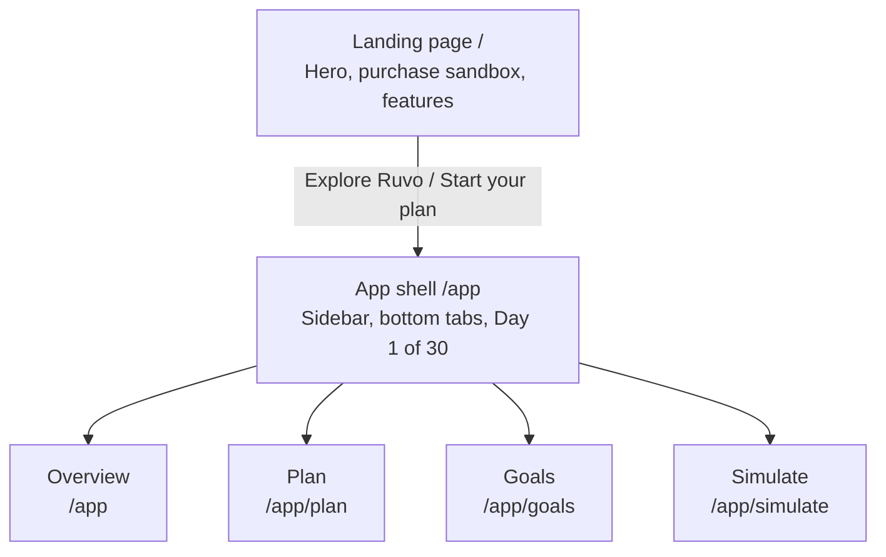

<div align="center">

  

  <h3>Understand your money. Plan your future.</h3>

  <p>
    A simulation-first personal finance app for Gen Z and early-career earners.<br />
    Plan a ₹10,000 budget over 30 days and stress-test purchases before you spend.
  </p>

  <p>
    <a href="https://react.dev/"></a>
    <a href="https://www.typescriptlang.org/"></a>
    <a href="https://vite.dev/"></a>
    <a href="https://tailwindcss.com/"></a>
    <a href="https://motion.dev/"></a>
    
  </p>

  <p>
    <a href="#overview">Overview</a> •
    <a href="#features">Features</a> •
    <a href="#getting-started">Getting Started</a> •
    <a href="#tech-stack">Tech Stack</a> •
    <a href="#project-structure">Structure</a> •
    <a href="#roadmap">Roadmap</a> •
    <a href="#contributing">Contributing</a>
  </p>

</div>

**Live demo:** [add your deployed URL here](https://example.com)

---

## Overview

Most finance tools are **retrospective**. They read bank feeds and show what you spent yesterday or last month. By the time a chart turns red, the money is gone.

Ruvo flips this with a **simulation-first** model:

- **Baseline plan:** a ₹10,000 starting budget mapped across 30 days.
- **Ring-fenced obligations:** bills, passes, subscriptions and savings targets are protected from discretionary spending.
- **Dynamic daily allowance:** how much you can safely spend today without breaking the rest of the month.
- **What-if foresight:** simulate purchases, income events or cancelled subscriptions before money leaves your account.
- **Private by design:** runs entirely in your browser. No bank linking, no UPI permissions, no cloud account.

---

## Features

### Live now

- **Landing page (`/`)**
  - Editorial hero with a live layered dashboard preview
  - Interactive purchase simulator with presets (₹500, ₹1,500, ₹3,000, ₹5,000)
  - Feature showcase: budget tracking, what-if simulator, savings, subscriptions, projections, risk index
  - Responsive header with smooth scrolling and a mobile drawer
- **App workspace (`/app`)**
  - Adaptive shell: desktop sidebar, mobile bottom tabs, "Day 1 of 30" cycle tracker
  - Overview dashboard with budget hero card and metric cards (`good`, `watch`, `bad` tones)
  - Placeholder routes for Plan, Goals and Simulate
- **Design system**
  - Semantic CSS-variable tokens wired into Tailwind
  - Integer-paise money handling with `formatMoney` (₹ notation)
  - Framer Motion animations that respect `prefers-reduced-motion`

### Coming next

See the [roadmap](#roadmap).

---

## Getting Started

**Requirements:** Node.js 18+ (20 LTS recommended) and npm 9+.

```bash
git clone https://github.com/RudranshCoder/Ruvo.git
cd Ruvo
npm install
npm run dev
```

Open the URL printed in the terminal (default `http://localhost:5173`).

No environment variables or API keys are needed. User data will live in browser `localStorage` under `ruvo:v1`.

### Scripts

| Script | What it does |
| :--- | :--- |
| `npm run dev` | Start the dev server with HMR |
| `npm run build` | Typecheck and build to `dist/` |
| `npm run typecheck` | Run `tsc --noEmit` |
| `npm run lint` | ESLint with zero warnings allowed |
| `npm test` | Run Vitest once |
| `npm run test:watch` | Vitest in watch mode |
| `npm run test:e2e` | Playwright end-to-end tests |

---

## Tech Stack

<details>
<summary>Show full stack</summary>

| Category | Technology | Purpose |
| :--- | :--- | :--- |
| UI | [React](https://react.dev/) 18 | Component framework |
| Language | [TypeScript](https://www.typescriptlang.org/) 5.7 | Static typing |
| Build | [Vite](https://vite.dev/) 6 | Dev server and bundler |
| Styling | [Tailwind CSS](https://tailwindcss.com/) 3.4 | Utility styling with token variables |
| Components | shadcn/ui pattern, `clsx`, `tailwind-merge`, `class-variance-authority` | Accessible, variant-driven primitives |
| Animation | [Motion / Framer Motion](https://motion.dev/) 11 | Transitions, springs, layout animation |
| Icons | [Lucide React](https://lucide.dev/) | UI icons |
| Routing | [React Router](https://reactrouter.com/) 6 | Client-side routing |
| State | [Zustand](https://zustand.docs.pmnd.rs/) 5 | Client store (Phase 3) |
| Validation | [Zod](https://zod.dev/) | Persistence schema validation |
| Forms | [React Hook Form](https://react-hook-form.com/) | Form state |
| Charts | [Recharts](https://recharts.org/) | Financial charts (Phase 5) |
| Unit tests | [Vitest](https://vitest.dev/) + JSDOM | Unit and component tests |
| E2E tests | [Playwright](https://playwright.dev/) | End-to-end tests |
| Linting | [ESLint](https://eslint.org/) 9 | TypeScript and React Hooks rules |

</details>

---

## How the Math Works

The full spec lives in [`docs/FINANCIAL_LOGIC.md`](docs/FINANCIAL_LOGIC.md).

1. **Safe-to-spend** (`S`): `S = Balance − U − G`, where `U` is unpaid commitments in the period and `G` is unfulfilled planned savings.
2. **Daily allowance** (`A`): `A = floor(max(0, S) / R)`, where `R = max(0, N − d + 1)` is the number of days remaining in the cycle.
3. **Simulation equivalence:** what-if scenarios never change real state. Once confirmed, the scenario result matches the actual post-transaction state to within 1 paise.

### App flow



---

## Project Structure

<details>
<summary>Show file tree</summary>

```text
Ruvo/
├── public/                    # Static assets (banner, logo, icon)
├── docs/                      # Architecture and product specs
│   ├── ARCHITECTURE.md
│   ├── DATA_MODEL.md
│   ├── DESIGN_SYSTEM.md
│   ├── FINANCIAL_LOGIC.md
│   ├── PRD.md
│   ├── TASKS.md
│   └── TESTING.md
├── src/
│   ├── components/
│   │   ├── layout/AppShell.tsx
│   │   └── ui/                # Badge, Button, Card, MetricCard, Progress
│   ├── domain/money.ts        # Integer-paise formatting (formatMoney)
│   ├── features/
│   │   ├── dashboard/DashboardPage.tsx
│   │   ├── landing/LandingPage.tsx
│   │   └── shared/ComingSoonPage.tsx
│   ├── lib/utils.ts           # clsx + tailwind-merge helper
│   ├── styles/                # globals.css, tokens.css
│   ├── App.tsx                # Routes
│   └── main.tsx               # Entry point
├── tests/                     # App.test.tsx, setup.ts
├── index.html
├── package.json
├── tailwind.config.ts
├── tsconfig.json
└── vite.config.ts
```

</details>

---

## Design System

Dark-first and typography-driven, built for financial clarity.

<details>
<summary>Color tokens</summary>

```css
:root {
  --bg-base:        #0B0B14;
  --bg-surface:     #14141F;
  --bg-elevated:    #1C1C2B;
  --border-subtle:  #2A2A3D;
  --brand:          #8B5CF6;
  --brand-soft:     #2A1F4D;
  --accent-lime:    #C6F432;
  --accent-cyan:    #22D3EE;
  --status-good:    #34D399;
  --status-watch:   #FBBF24;
  --status-bad:     #FB7185;
  --text-primary:   #F4F4FA;
  --text-secondary: #A3A3BA;
}
```

</details>

- **Typography:** Unbounded for headings and large figures, Albert Sans for interface and body text.
- **Motion:** spring-based transitions, with `prefers-reduced-motion` honored in CSS and via `useReducedMotion()`.
- **Touch targets:** interactive elements are at least 44×44 px.

---

## Roadmap

Detailed in [`docs/TASKS.md`](docs/TASKS.md).

- [x] **Phase 1:** landing page, app shell, design system
- [ ] **Phase 2: Domain engine.** Pure functions (`computeSnapshot`, `simulate`) in `src/domain/` with fixture-driven tests
- [ ] **Phase 3: State and persistence.** Zustand slices, `ruvo:v1` localStorage storage, Zod validation and corrupted-storage recovery
- [ ] **Phase 4: Tracking.** Category budgets, subscription and commitment calendar with mark-as-paid, priority-based savings goals
- [ ] **Phase 5: Full simulator and charts.** Multi-scenario comparison with confirm or discard, Recharts 30-day trajectories and category breakdowns

---

## Deployment

Ruvo is a static SPA. Build with `npm run build` and host the `dist/` folder anywhere.

**Vercel:** set the framework preset to Vite, then add a `vercel.json` for client-side routing:

```json
{
  "rewrites": [{ "source": "/(.*)", "destination": "/index.html" }]
}
```

**Netlify:** add `public/_redirects` containing `/*    /index.html   200`, then deploy `dist/`.

---

## Contributing

Contributions and feedback are welcome.

1. Fork the repo and create a branch: `git checkout -b feat/your-feature`
2. Follow the project rules:
   - Keep pure domain logic in `src/domain/`, with no UI or state dependencies
   - Store money as integer paise and format it with `formatMoney`
   - Use design tokens instead of hardcoded colors
3. Make sure these pass: `npm run lint && npm run typecheck && npm test && npm run build`
4. Use [Conventional Commits](https://www.conventionalcommits.org/), for example `feat(ui): add category budget progress bar`
5. Open a pull request with a short description

---

## License

Released under the [MIT License](LICENSE).